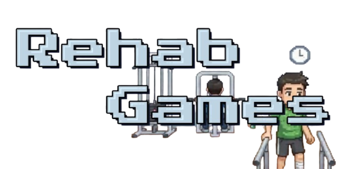
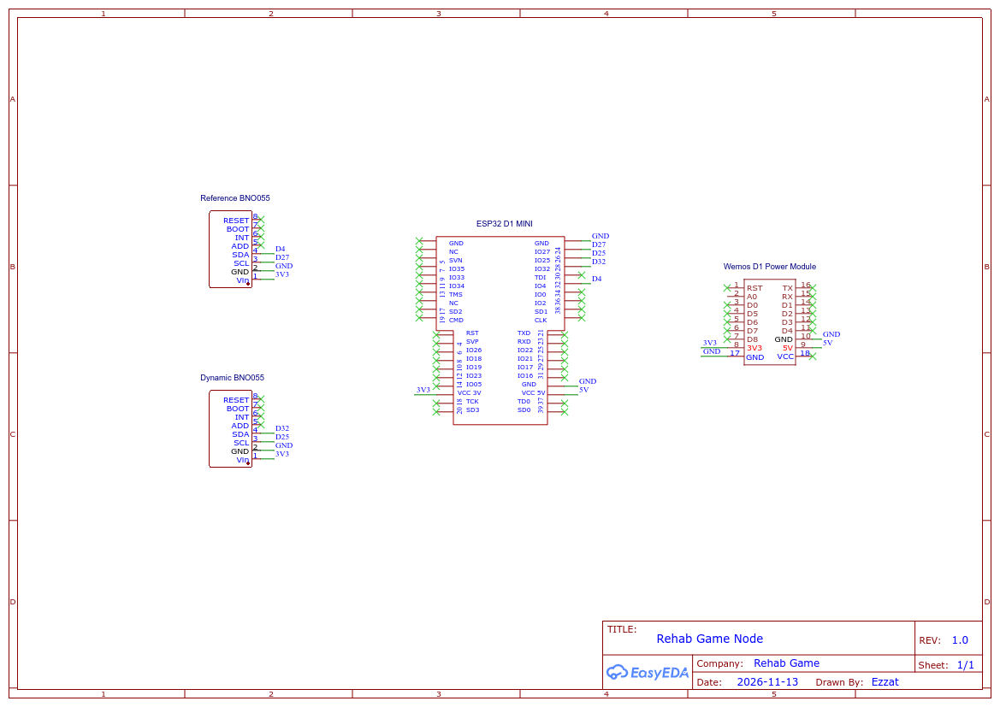

<p align="center">
  
</p>

<h1 align="center">Rehab Games</h1>

<p align="center">
  <b>Dual-BNO055 ESP32 Knee Rehabilitation Biomechanical Telemetry &amp; Exergaming Platform</b>
</p>

<p align="center">
  <a href="esp32/PINOUT_AND_WIRING.md"></a>
  <a href="esp32/BLUETOOTH_TELEMETRY.md"></a>
  <a href="esp32/BLUETOOTH_TELEMETRY.md"></a>
  <a href="docs/TELEMETRY_AND_SCORING.md"></a>
  <a href="docs/TELEMETRY_AND_SCORING.md"></a>
  <a href="docs/TELEMETRY_AND_SCORING.md"></a>
</p>

> **Rehab Games** is an interactive clinical exergaming and biomechanical biofeedback platform for lower-limb knee rehabilitation. Combining an untethered **ESP32 wearable node** equipped with **dual Bosch BNO055 orientation sensors** running magnetic-decoupled **6-DoF IMU fusion** with a **Godot Engine 4.4 Flappy Bird exergame**, it transforms repetitive knee flexion and extension therapy into an engaging, gamified recovery session with real-time Range of Motion (ROM) calibration and automated patient scoring records.

---

## 📑 Language Options / Pilihan Bahasa
* 🇬🇧 **[English Documentation (Current)](README.md)**
* 🇲🇾 **[Dokumentasi Bahasa Melayu](README_MY.md)**

---

## 🏗️ High-Level System Architecture

```text
+---------------------------------------------------------------------------------------------------+
|                                     REHAB GAMES SYSTEM TOPOLOGY                                   |
+---------------------------------------------------------------------------------------------------+

     [ PATIENT WEARABLE SENSORS ]                                     [ CLINICAL PC PLATFORM ]
     Folder: esp32/                                                   Folder: Godot/ & docs/

  +-------------------------------+                               +-------------------------------+
  |    THIGH SENSOR (PROXIMAL)    |                               |    PYTHON TELEMETRY BRIDGE    |
  |  - BNO055 @ I2C Bus 0 (4/27)  |                               |    (`bridge-with-value.py`)   |
  |  - 6-DoF OPERATION_MODE_IMUPLUS|                               |  - Windows Registry Discovery |
  +-------------------------------+                               |  - Likelihood Score Ranking   |
                  \                                               |  - Active Telemetry Handshake |
                   v                                              |  - Auto-Reconnect Watchdog    |
  +-------------------------------+   Bluetooth Classic 2.1 SPP   +-------------------------------+
  |     ESP32 EDGE COMPUTATION    | ============================>                 |
  |  - Baseline Extension Zeroing |      ("ESP32_Rehab_Knee")                     | UDP Datagrams
  |  - Dot-Product Gravity Fusion |      20 Hz (115200 baud)                      | 127.0.0.1:4242
  |  - Low-Pass EMA Filter (0.15) |                                               v
  |  - NaN & Wire-Bump Resilience |                               +-------------------------------+
  +-------------------------------+                               |     GODOT 4.4 REHAB EXERGAME  |
                   ^                                              |  - PacketPeerUDP Ingestion    |
                  /                                               |  - Clinical ROM Calibration   |
  +-------------------------------+                               |  - Flight remap() Kinematics  |
  |     CALF SENSOR (DISTAL)      |                               |  - Monospaced Leaderboard UI  |
  |  - BNO055 @ I2C Bus 1 (32/25) |                               +-------------------------------+
  |  - 6-DoF OPERATION_MODE_IMUPLUS|                                               |
  +-------------------------------+                                               v
                                                                  +-------------------------------+
                                                                  |    PATIENT PERSISTENT STORE   |
                                                                  |   `user://leaderboard.json`   |
                                                                  |   (%APPDATA%\Godot\...\)      |
                                                                  +-------------------------------+
```

---

## 🔌 Hardware Circuit & Wiring Schematic

The physical hardware implementation—routing the dual **Bosch BNO055** smart orientation sensors over independent **I2C Bus 0** and **I2C Bus 1** controllers on the **ESP32**—is verified in the schematic below:

<p align="center">
  
</p>

* 📄 **Download Printable Schematic PDF:** [`Schematic_rehabgame_2026-11-13.pdf`](Schematic_rehabgame_2026-11-13.pdf)
* 📄 **Download Vector Schematic SVG:** [`schematic.svg`](schematic.svg)
* 📄 **Detailed Wiring & Pinout Guide:** [`esp32/PINOUT_AND_WIRING.md`](esp32/PINOUT_AND_WIRING.md)

---

## 📌 Hardware Pinout Table

| ESP32 Pin | Connected Component | Module Pin | Bus / Signal | Operating Voltage | Function & Technical Description |
| :--- | :--- | :--- | :--- | :--- | :--- |
| **GPIO 4** | Thigh IMU (#1) | `SDA` | I2C Bus 0 (`Wire`) | 3.3V Logic | Serial Data Line for Proximal Thigh orientation |
| **GPIO 27** | Thigh IMU (#1) | `SCL` | I2C Bus 0 (`Wire`) | 3.3V Logic | Serial Clock Line for Proximal Thigh orientation |
| **GPIO 32** | Calf IMU (#2) | `SDA` | I2C Bus 1 (`TwoWire(1)`) | 3.3V Logic | Serial Data Line for Distal Calf orientation |
| **GPIO 25** | Calf IMU (#2) | `SCL` | I2C Bus 1 (`TwoWire(1)`) | 3.3V Logic | Serial Clock Line for Distal Calf orientation |
| **3V3** | BNO055 #1 &amp; #2 | `VIN` / `VCC` | Power Rail | 3.3V DC | Onboard regulated 3.3V output powering both sensors |
| **GND** | BNO055 #1 &amp; #2 | `GND` | Ground Rail | 0V | Common system ground reference plane |

---

## ✨ Key Features & Algorithmic Highlights

### 1. Magnetic-Decoupled 6-DoF Kinematics (`OPERATION_MODE_IMUPLUS`)
* Locks both Bosch BNO055 sensors into Accelerometer + Gyroscope vector fusion with the magnetometer **permanently disabled**.
* Completely eliminates severe heading distortion and "angle zero drops" caused by magnetic interference from metal chairs, clinical hospital beds, and moving sensor wiring.

### 2. Analytical Dot-Product Joint Angle Formulation
* Derives knee flexion angle directly from normalized gravity vectors ($\vec{g}_{\text{thigh}}$ and $\vec{g}_{\text{calf}}$) using vector dot product: $\cos\theta = \frac{\vec{g}_1 \cdot \vec{g}_2}{|\vec{g}_1| |\vec{g}_2|}$.
* Mathematically clamped to eliminate Euler angle singularities (*gimbal lock*) and smoothed via an Exponential Moving Average (EMA) low-pass filter ($\alpha = 0.15$).

### 3. Wire-Bump Guard & I2C Self-Healing Watchdog
* Checks earth gravity vector magnitude ($|\vec{g}|^2 \ge 9.0$) before angle calculation, discarding glitch frames to prevent `0/0 = NaN` filter corruption.
* Includes a 30ms I2C timeout and an autonomous 20-frame watchdog that softly re-initializes sensor registers if loose cables drop bus communication.

### 4. Zero-Configuration Windows Registry Auto-Discovery
* Python telemetry bridge dynamically scans `HKLM\SYSTEM\CurrentControlSet\Enum\BTHENUM` and `SERIALCOMM` to locate the active `ESP32_Rehab_Knee` outbound COM port.
* Probes candidate ports with an active 1.8-second numeric handshake, eliminating frozen connections on inbound ports and automatically recovering if Bluetooth is briefly disconnected.

### 5. Interactive Clinical ROM Calibration & Flappy Bird Exergame
* **Clinical Calibration Modal:** Clinicians lock the patient's individual straight baseline (`min_angle`) and maximum comfortable flexion (`max_angle`), displaying active range on a 0% to 100% visual gauge.
* **Biomechanical Flight Remapping:** Dynamically maps patient knee flexion to the on-screen bird Y-coordinate (`remap(angle, min, max, 650px, 25px)`) with exponential smoothing (`lerp()`).
* **Session Score Persistence:** Automatically saves patient exercise scores, dates, and historical high scores to `%APPDATA%\Godot\app_userdata\Rehab Games\leaderboard.json`.

---

## 📂 Repository Structure

```text
.
├── README.md                           # Master Project Documentation (English)
├── README_MY.md                        # Master Project Documentation (Bahasa Melayu)
├── Schematic_rehabgame_2026-11-13.png  # High-Resolution Hardware Circuit Schematic
├── Schematic_rehabgame_2026-11-13.pdf  # Printable CAD Schematic PDF
├── schematic.svg                       # Infinite-Resolution Vector Circuit Schematic
├── logo.svg                            # Project Vector Logo
├── favicon.svg                         # Vector Browser / System Favicon
├── favicon.ico                         # Multi-Resolution Desktop Icon
├── icon.png                            # Raster Source Icon
├── .gitignore                          # Git Exclusion Rules
│
├── esp32/                              # Production Embedded Firmware & Hardware Docs
│   ├── README.md / README_MY.md        # Hardware Architecture & BOM Overview
│   ├── PINOUT_AND_WIRING.md / _MY.md   # Dual-Bus Pinout, Schematics & Safety
│   ├── BLUETOOTH_TELEMETRY.md / _MY.md # SPP Framing, Dot-Product & EMA Math
│   ├── FLASHING_AND_SETUP.md / _MY.md  # Toolchain, Libraries & Calibration Guide
│   ├── schematic.svg / .pdf / .png     # Hardware CAD Schematics
│   └── esp32_rehab_knee/
│       └── esp32_rehab_knee.ino        # Production ESP32 Dual-BNO055 Firmware
│
├── docs/                               # System & Telemetry Integration Documentation
│   ├── TELEMETRY_AND_SCORING.md        # Python Bridge, Calibration & JSON Scoring (EN)
│   └── TELEMETRY_AND_SCORING_MY.md     # Python Bridge, Calibration & JSON Scoring (MY)
│
└── Godot/                              # Godot Engine 4.4 Rehabilitation Exergame Project
    ├── project.godot                   # Master Engine Configuration
    ├── export_presets.cfg              # Windows Desktop Export Specification
    ├── bridge-with-value.py            # Autonomous WinReg Telemetry Bridge
    ├── scripts/                        # Engine Scripting (Bridge Launcher, Sound, etc.)
    ├── games/flappy_bird/scripts/      # Game Kinematics (main.gd, bird.gd, leaderboard)
    ├── assets/fonts/                   # Retro Fonts (PressStart2P, Minecraftia)
    └── resources/                      # UI Themes & Bus Layouts
```

---

## 📖 Subsystem Documentation Directory

### 🔌 Embedded Hardware (`esp32/`)
* 🧰 **Hardware Overview & Architecture:** [English](esp32/README.md) • [Bahasa Melayu](esp32/README_MY.md)
* ⚡ **Pinout, Schematics & Wiring Guide:** [English](esp32/PINOUT_AND_WIRING.md) • [Bahasa Melayu](esp32/PINOUT_AND_WIRING_MY.md)
* 📡 **Bluetooth Telemetry & Kinematics:** [English](esp32/BLUETOOTH_TELEMETRY.md) • [Bahasa Melayu](esp32/BLUETOOTH_TELEMETRY_MY.md)
* 💾 **Flashing & Device Setup Guide:** [English](esp32/FLASHING_AND_SETUP.md) • [Bahasa Melayu](esp32/FLASHING_AND_SETUP_MY.md)

### 🎮 Telemetry Bridge, Game & Scoring (`docs/`)
* 🕹️ **Telemetry Bridge & Patient Scoring Guide:** [English](docs/TELEMETRY_AND_SCORING.md) • [Bahasa Melayu](docs/TELEMETRY_AND_SCORING_MY.md)

---

## 🚀 Quick Start Guide

### 1. Flash the ESP32 Wearable Node
1. Open [`esp32/esp32_rehab_knee/esp32_rehab_knee.ino`](esp32/esp32_rehab_knee/esp32_rehab_knee.ino) in Arduino IDE.
2. Select Board: **ESP32 Dev Module**, verify libraries (`Adafruit BNO055`, `Adafruit Unified Sensor`).
3. Flash the firmware via USB-UART cable.

### 2. Pair Bluetooth on Windows PC (One-Time Setup)
1. Turn on the ESP32 node.
2. On Windows: Go to **Settings** $\rightarrow$ **Bluetooth & devices** $\rightarrow$ **Add device** $\rightarrow$ **Bluetooth**.
3. Select and pair with **`ESP32_Rehab_Knee`**.

### 3. Install Host Dependencies
On the clinical PC (Windows Terminal or Command Prompt):
```cmd
pip install pyserial
```

### 4. Launch the Application
Run the game executable:
* **Production Game:** Double-click `Rehab Games.exe`.
* **Diagnostic Mode:** Double-click `Rehab Games.console.exe` to observe live serial detection and telemetry logs in real time.

---

## 📜 License
* Developed for **Educational Purposes Only**.
