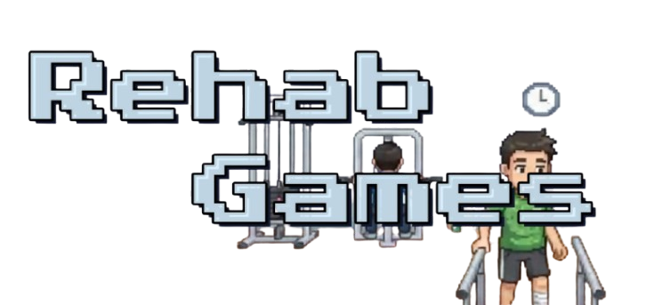
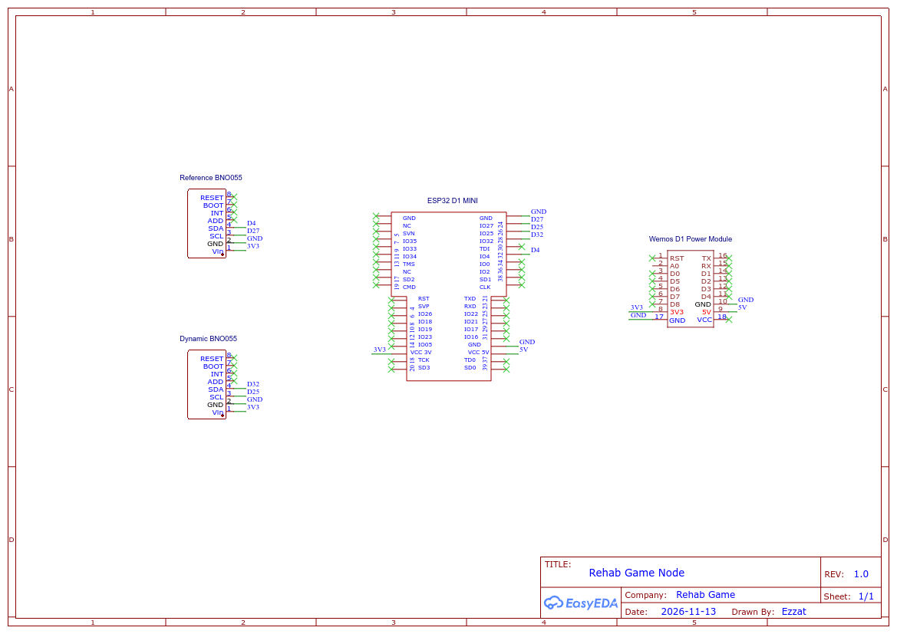

<p align="center">
  
</p>

<h1 align="center">Rehab Games</h1>

<p align="center">
  <b>Platform Telemetri Biomekanik &amp; Permainan Pemulihan Lutut ESP32 Dwi-BNO055</b>
</p>

<p align="center">
  <a href="esp32/PINOUT_AND_WIRING_MY.md"></a>
  <a href="esp32/BLUETOOTH_TELEMETRY_MY.md"></a>
  <a href="esp32/BLUETOOTH_TELEMETRY_MY.md"></a>
  <a href="docs/TELEMETRY_AND_SCORING_MY.md"></a>
  <a href="docs/TELEMETRY_AND_SCORING_MY.md"></a>
  <a href="docs/TELEMETRY_AND_SCORING_MY.md"></a>
</p>

> **Rehab Games** ialah platform permainan pemulihan klinikal (*exergaming*) dan biofeedback biomekanik bagi pemulihan sendi lutut anggota bawah. Menggabungkan **nod penderia boleh pakai ESP32** tanpa wayar yang dilengkapi **dua penderia orientasi mutlak Bosch BNO055** yang beroperasi dalam mod gabungan **6-DoF IMU** (bebas herotan magnetik) bersama **permainan pemulihan Godot Engine 4.4 Flappy Bird**, sistem ini mengubah senaman fleksi dan ekstensi lutut yang membosankan menjadi sesi pemulihan interaktif bergamifikasi dengan penentukuran julat pergerakan (*Range of Motion - ROM*) serta simpanan rekod markah pesakit secara automatik.

---

## 📑 Pilihan Bahasa / Language Options
* 🇲🇾 **[Dokumentasi Bahasa Melayu (Semasa)](README_MY.md)**
* 🇬🇧 **[English Documentation](README.md)**

---

## 🏗️ Seni Bina Sistem Tahap Tinggi

```text
+---------------------------------------------------------------------------------------------------+
|                                      TOPOLOGI SISTEM REHAB GAMES                                  |
+---------------------------------------------------------------------------------------------------+

     [ PENDERIA BOLEH PAKAI PESAKIT ]                                 [ PLATFORM KOMPUTER KLINIKAL ]
     Folder: esp32/                                                   Folder: Godot/ & docs/

  +-------------------------------+                               +-------------------------------+
  |     PENDERIA PEHA (PROXIMAL)  |                               |    JAMBATAN TELEMETRI PYTHON  |
  |  - BNO055 @ I2C Bus 0 (4/27)  |                               |    (`bridge-with-value.py`)   |
  |  - 6-DoF OPERATION_MODE_IMUPLUS|                               |  - Imbasan Windows Registry   |
  +-------------------------------+                               |  - Penarafan Skor Kebarangkalian
                  \                                               |  - Ujian Jabat Tangan Aktif   |
                   v                                              |  - Sambungan Semula Automatik |
  +-------------------------------+   Bluetooth Klasik 2.1 SPP    +-------------------------------+
  |    PEMPROSESAN PINGGIR ESP32  | ============================>                 |
  |  - Penentukuran Sifar Asas    |      ("ESP32_Rehab_Knee")                     | Paket UDP
  |  - Produk Titik Vektor Graviti|      20 Hz (115200 baud)                      | 127.0.0.1:4242
  |  - Penapis EMA Licin (0.15)   |                                               v
  |  - Kebal NaN & Gegaran Wayar  |                               +-------------------------------+
  +-------------------------------+                               |    PERMAINAN REHAB GODOT 4.4  |
                   ^                                              |  - Penerimaan PacketPeerUDP   |
                  /                                               |  - Penentukuran Klinikal ROM  |
  +-------------------------------+                               |  - Kinematik Penerbangan remap|
  |    PENDERIA BETIS (DISTAL)    |                               |  - Papan Markah Retro         |
  |  - BNO055 @ I2C Bus 1 (32/25) |                               +-------------------------------+
  |  - 6-DoF OPERATION_MODE_IMUPLUS|                                               |
  +-------------------------------+                                               v
                                                                  +-------------------------------+
                                                                  |    SIMPANAN KEKAL REKOD       |
                                                                  |   `user://leaderboard.json`   |
                                                                  |   (%APPDATA%\Godot\...\)      |
                                                                  +-------------------------------+
```

---

## 🔌 Skematik Litar & Pendawaian Perkakasan

Sambungan fizikal perkakasan—yang menghubungkan dua unit penderia pintar **Bosch BNO055** melalui pengawal bebas **I2C Bus 0** dan **I2C Bus 1** pada **ESP32**—diperincikan dalam skematik litar di bawah:

<p align="center">
  
</p>

* 📄 **Muat Turun Skematik Format PDF (Boleh Dicetak):** [`Schematic_rehabgame_2026-11-13.pdf`](Schematic_rehabgame_2026-11-13.pdf)
* 📄 **Muat Turun Vektor Skematik SVG:** [`schematic.svg`](schematic.svg)
* 📄 **Panduan Pendawaian & Penetapan Pin Terperinci:** [`esp32/PINOUT_AND_WIRING_MY.md`](esp32/PINOUT_AND_WIRING_MY.md)

---

## 📌 Jadual Penetapan Pin Mikropengawal

| Pin ESP32 | Komponen Disambung | Pin Modul | Isyarat / Bus | Voltan Operasi | Fungsi & Keterangan Teknikal |
| :--- | :--- | :--- | :--- | :--- | :--- |
| **GPIO 4** | Penderia Peha (#1) | `SDA` | I2C Bus 0 (`Wire`) | Logik 3.3V | Talian Data Bersiri bagi orientasi segmen Peha |
| **GPIO 27** | Penderia Peha (#1) | `SCL` | I2C Bus 0 (`Wire`) | Logik 3.3V | Talian Jam Bersiri bagi orientasi segmen Peha |
| **GPIO 32** | Penderia Betis (#2) | `SDA` | I2C Bus 1 (`TwoWire(1)`) | Logik 3.3V | Talian Data Bersiri bagi orientasi segmen Betis |
| **GPIO 25** | Penderia Betis (#2) | `SCL` | I2C Bus 1 (`TwoWire(1)`) | Logik 3.3V | Talian Jam Bersiri bagi orientasi segmen Betis |
| **3V3** | BNO055 #1 &amp; #2 | `VIN` / `VCC` | Rel Kuasa | 3.3V DC | Bekalan kuasa terkawal 3.3V bagi kedua-dua sensor |
| **GND** | BNO055 #1 &amp; #2 | `GND` | Rel Bumi | 0V | Satah rujukan bumi sepunya (*Common Ground*) |

---

## ✨ Ciri-Ciri Utama & Kelebihan Algoritma

### 1. Kinematik 6-DoF Bebas Gangguan Magnetik (`OPERATION_MODE_IMUPLUS`)
* Mengunci kedua-dua penderia Bosch BNO055 ke dalam mod gabungan Vektor Accelerometer + Gyroscope dengan magnetometer **dimatikan sepenuhnya**.
* Menghapuskan herotan arah (*heading distortion*) dan masalah sudut jatuh ke sifar akibat gangguan kerusi besi, katil rawatan hospital, dan pergerakan kabel wayar.

### 2. Formulasi Sudut Sendi Melalui Produk Titik Vektor
* Mengira sudut fleksi lutut secara terus daripada vektor graviti ternormal ($\vec{g}_{\text{peha}}$ dan $\vec{g}_{\text{betis}}$) menggunakan produk titik: $\cos\theta = \frac{\vec{g}_1 \cdot \vec{g}_2}{|\vec{g}_1| |\vec{g}_2|}$.
* Dikunci secara matematik daripada ralat singulariti *gimbal lock* dan ditapis dengan penapis laluan rendah purata bergerak eksponen (EMA, $\alpha = 0.15$).

### 3. Perlindungan Gegaran Wayar & Pemulihan Kendiri I2C
* Memeriksa magnitud graviti bumi ($|\vec{g}|^2 \ge 9.0$) sebelum membuat pengiraan sudut, membuang bingkai data rosak bagi menghalang pencemaran penapis oleh ralat `0/0 = NaN`.
* Dilengkapi had masa I2C 30ms dan algoritma pemantau (*watchdog*) 20-bingkai yang memulihkan daftar penderia secara lembut jika wayar longgar seketika.

### 4. Penemuan Port Pintar Windows Registry Tanpa Konfigurasi Manual
* Jambatan telemetri Python mengimbas kunci `HKLM\SYSTEM\CurrentControlSet\Enum\BTHENUM` dan `SERIALCOMM` secara dinamik untuk mengesan port COM keluar bagi `ESP32_Rehab_Knee`.
* Menjalankan ujian jabat tangan 1.8 saat dengan mengesahkan aliran nombor perpuluhan sah, mengelakkan perisian daripada sangkut pada port masuk (*inbound*) dan automatik bersambung semula jika Bluetooth terputus.

### 5. Penentukuran ROM Klinikal & Permainan Pemulihan Flappy Bird
* **Modal Penentukuran Klinikal:** Fisioterapi mengunci had kaki lurus pesakit (`min_angle`) dan fleksi maksimum yang selesa (`max_angle`), memaparkan julat pergerakan aktif pada tolok visual 0% hingga 100%.
* **Pemetaan Kinematik Penerbangan:** Memetakan fleksi lutut pesakit kepada koordinat menegak burung di skrin secara dinamik (`remap(angle, min, max, 650px, 25px)`) dengan pergerakan licin (`lerp()`).
* **Penyimpanan Rekod Sesi Pesakit:** Menyimpan markah latihan, tarikh, dan rekod sejarah pesakit secara automatik ke dalam fail `%APPDATA%\Godot\app_userdata\Rehab Games\leaderboard.json`.

---

## 📂 Struktur Repositori

```text
.
├── README.md                           # Dokumentasi Induk Projek (Bahasa Inggeris)
├── README_MY.md                        # Dokumentasi Induk Projek (Bahasa Melayu)
├── Schematic_rehabgame_2026-11-13.png  # Skematik Litar Perkakasan Resolusi Tinggi
├── Schematic_rehabgame_2026-11-13.pdf  # Format PDF Skematik Boleh Dicetak
├── schematic.svg                       # Vektor Skematik CAD Resolusi Tanpa Had
├── logo.svg                            # Vektor Logo Projek
├── favicon.svg                         # Vektor Favicon Sistem
├── favicon.ico                         # Ikon Desktop Pelbagai Resolusi
├── icon.png                            # Ikon Sumber Raster
├── .gitignore                          # Peraturan Pengecualian Git
│
├── esp32/                              # Perisian Tegar Pengeluaran & Dokumen Perkakasan
│   ├── README.md / README_MY.md        # Gambaran Keseluruhan Seni Bina & BOM
│   ├── PINOUT_AND_WIRING.md / _MY.md   # Penetapan Pin, Skematik & Keselamatan
│   ├── BLUETOOTH_TELEMETRY.md / _MY.md # Protokol SPP, Matematik Produk Titik & EMA
│   ├── FLASHING_AND_SETUP.md / _MY.md  # Panduan Rantaian Alat, Pustaka & Kalibrasi
│   ├── schematic.svg / .pdf / .png     # Skematik CAD Perkakasan
│   └── esp32_rehab_knee/
│       └── esp32_rehab_knee.ino        # Kod Sumber Firmware Pengeluaran ESP32
│
├── docs/                               # Dokumentasi Integrasi Sistem & Telemetri
│   ├── TELEMETRY_AND_SCORING.md        # Panduan Jambatan Python & Markah JSON (EN)
│   └── TELEMETRY_AND_SCORING_MY.md     # Panduan Jambatan Python & Markah JSON (MY)
│
└── Godot/                              # Projek Permainan Pemulihan Godot Engine 4.4
    ├── project.godot                   # Konfigurasi Induk Enjin
    ├── export_presets.cfg              # Spesifikasi Eksport Windows Desktop
    ├── bridge-with-value.py            # Jambatan Telemetri Pintar WinReg
    ├── scripts/                        # Skrip Enjin (Pelancar Jambatan, Audio, dll)
    ├── games/flappy_bird/scripts/      # Kinematik Permainan (main.gd, bird.gd, markah)
    ├── assets/fonts/                   # Fon Retro (PressStart2P, Minecraftia)
    └── resources/                      # Tema UI & Susun Atur Audio
```

---

## 📖 Indeks Dokumentasi Subsistem

### 🔌 Perkakasan Terbenam (`esp32/`)
* 🧰 **Gambaran Keseluruhan & Seni Bina Perkakasan:** [English](esp32/README.md) • [Bahasa Melayu](esp32/README_MY.md)
* ⚡ **Penetapan Pin, Skematik & Pendawaian:** [English](esp32/PINOUT_AND_WIRING.md) • [Bahasa Melayu](esp32/PINOUT_AND_WIRING_MY.md)
* 📡 **Telemetri Bluetooth & Matematik Kinematik:** [English](esp32/BLUETOOTH_TELEMETRY.md) • [Bahasa Melayu](esp32/BLUETOOTH_TELEMETRY_MY.md)
* 💾 **Panduan Pengaturcaraan & Kalibrasi:** [English](esp32/FLASHING_AND_SETUP.md) • [Bahasa Melayu](esp32/FLASHING_AND_SETUP_MY.md)

### 🎮 Jambatan Telemetri, Permainan & Skor (`docs/`)
* 🕹️ **Panduan Jambatan Telemetri & Simpanan Markah:** [English](docs/TELEMETRY_AND_SCORING.md) • [Bahasa Melayu](docs/TELEMETRY_AND_SCORING_MY.md)

---

## 🚀 Panduan Permulaan Pantas

### 1. Muat Naik Perisian Tegar ESP32
1. Buka fail [`esp32/esp32_rehab_knee/esp32_rehab_knee.ino`](esp32/esp32_rehab_knee/esp32_rehab_knee.ino) di dalam Arduino IDE.
2. Pilih Papan: **ESP32 Dev Module**, pastikan pustaka (`Adafruit BNO055`, `Adafruit Unified Sensor`) telah dipasang.
3. Muat naik (*flash*) perisian tegar menggunakan kabel USB UART.

### 2. Padankan Bluetooth di Komputer Windows (Sekali Sahaja)
1. Hidupkan nod penderia ESP32.
2. Di Windows: Buka **Settings** $\rightarrow$ **Bluetooth & devices** $\rightarrow$ **Add device** $\rightarrow$ **Bluetooth**.
3. Pilih dan padankan dengan **`ESP32_Rehab_Knee`**.

### 3. Pasang Keperluan Pustaka di Komputer
Pada komputer Windows (Command Prompt atau PowerShell):
```cmd
pip install pyserial
```

### 4. Jalankan Permainan
Buka folder permainan dan klik dua kali pada fail:
* **Mod Permainan Biasa:** Klik dua kali `Rehab Games.exe`.
* **Mod Diagnostik / Pantau:** Klik dua kali `Rehab Games.console.exe` untuk melihat log penemuan port Bluetooth dan bacaan sudut telemetri secara masa nyata.

---

## 📜 Lesen
* Dibangunkan untuk **Tujuan Pendidikan Sahaja** (*Educational Purposes Only*).
