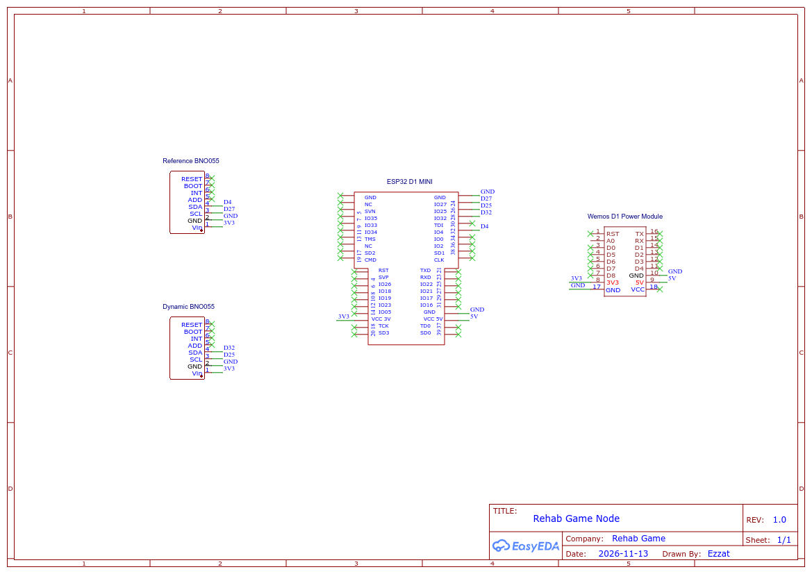

# 🔌 Hardware Pinout, Circuit Schematic & Wiring Guide (`esp32`)

This document outlines the detailed physical interconnects, pinout assignments, dual-bus I2C routing, and electrical schematic for the **ESP32 Dual-BNO055 Knee Rehabilitation Wearable Node**.

---

## 📑 Language Options / Pilihan Bahasa
* 🇬🇧 **[English Documentation (Current)](PINOUT_AND_WIRING.md)**
* 🇲🇾 **[Dokumentasi Bahasa Melayu](PINOUT_AND_WIRING_MY.md)**

---

## 🖼️ Hardware Circuit & Wiring Schematic

  

* 📄 **Download Printable Schematic PDF:** [`Schematic_rehabgame_2026-11-13.pdf`](Schematic_rehabgame_2026-11-13.pdf)
* 📄 **Download Vector Schematic SVG:** [`schematic.svg`](schematic.svg)

---

## 📌 Microcontroller Pinout Table

| ESP32 Pin | Connected Component | Module Pin | Bus / Signal | Operating Voltage | Function & Technical Description |
| :--- | :--- | :--- | :--- | :--- | :--- |
| **GPIO 4** | Thigh IMU (#1) | `SDA` | I2C Bus 0 (`Wire`) | 3.3V Logic | Serial Data Line for Proximal Thigh orientation |
| **GPIO 27** | Thigh IMU (#1) | `SCL` | I2C Bus 0 (`Wire`) | 3.3V Logic | Serial Clock Line for Proximal Thigh orientation |
| **GPIO 32** | Calf IMU (#2) | `SDA` | I2C Bus 1 (`TwoWire(1)`) | 3.3V Logic | Serial Data Line for Distal Calf orientation |
| **GPIO 25** | Calf IMU (#2) | `SCL` | I2C Bus 1 (`TwoWire(1)`) | 3.3V Logic | Serial Clock Line for Distal Calf orientation |
| **3V3** | BNO055 #1 &amp; #2 | `VIN` / `VCC` | Power Rail | 3.3V DC | Onboard regulated 3.3V output powering both sensors |
| **GND** | BNO055 #1 &amp; #2 | `GND` | Ground Rail | 0V | Common system ground reference plane |

### Protocol Configuration & Addressing Pins (BNO055 Breakouts)

| Sensor Pin | Hardware Connection | Configured State | Functional Objective |
| :--- | :--- | :--- | :--- |
| **PS0** | Sambung ke **GND** | Logic LOW | Selects standard I2C communication protocol |
| **PS1** | Sambung ke **GND** | Logic LOW | Selects standard I2C communication protocol |
| **ADR / COM** | Sambung ke **GND** | Logic LOW | Establishes default I2C base address **`0x29`** on each independent bus |
| **RST** | Sambung ke **3.3V** / Float | Logic HIGH | Keeps BNO055 out of reset (internal pull-up enabled) |

---

## 🧰 Bill of Materials (BOM)

| Item | Component | Specification | Quantity | Primary Purpose |
| :--- | :--- | :--- | :---: | :--- |
| 1 | **ESP32 DevKit** | 240 MHz Dual-Core Tensilica LX6, Bluetooth Classic 4.2 BR/EDR | 1 | Master kinematic processing & telemetry edge node |
| 2 | **Bosch BNO055** | Intelligent 9-axis Absolute Orientation Sensor | 2 | Sagittal gravity vector extraction for Thigh & Calf segments |
| 3 | **Elastic Velcro Straps** | Medical-grade breathable elastic fabric | 2 | Secure anatomical fastening to upper thigh and lower shank |
| 4 | **Flexible Silicone Wires** | 28 AWG multi-strand, high flex life | 1 set | Strain-resistant knee flexion articulation routing |
| 5 | **Power Source** | 3.7V Li-ion battery (with 5V boost) or 5V Power Bank | 1 | Portable, patient-safe untethered clinical operation |
| 6 | **Enclosure Casing** | 3D-printed PETG / PLA lightweight housing | 2 | Mechanical impact protection and sensor alignment |

---

## ⚡ Electrical & Mechanical Engineering Safeguards

1. **Dual Independent Physical I2C Buses:**
   - Rather than sharing a single bus with hardware address toggling (`0x28` / `0x29`), the firmware utilizes the ESP32 hardware dual TwoWire controllers (`Wire` and `TwoWire(1)`).
   - This eliminates I2C address conflict risks, halves bus capacitance loading, and prevents sensor cross-talk during rapid leg movements.
2. **I2C Bus Freeze Protection (`Wire.setTimeOut(30)`):**
   - Standard ESP32 Wire implementations can indefinitely block the CPU if an I2C clock line is pulled low during a loose cable disturbance.
   - Hardware timeout guards are enforced at `30 ms` on both buses, enabling automatic recovery without CPU crash.
3. **Decoupling Capacitors & Noise Rejection:**
   - Each BNO055 breakout board includes onboard 100 nF ceramic decoupling capacitors across `VIN` and `GND`.
   - Onboard 4.7 kΩ / 10 kΩ pull-up resistors on SDA/SCL lines maintain crisp rise times over flexible knee wire extensions up to 60 cm.
4. **Wire Strain Relief:**
   - All wiring crossing the joint pivot must feature spiral protective wrap and service loops at the knee flexion apex to eliminate mechanical tension during deep 90° squats.
