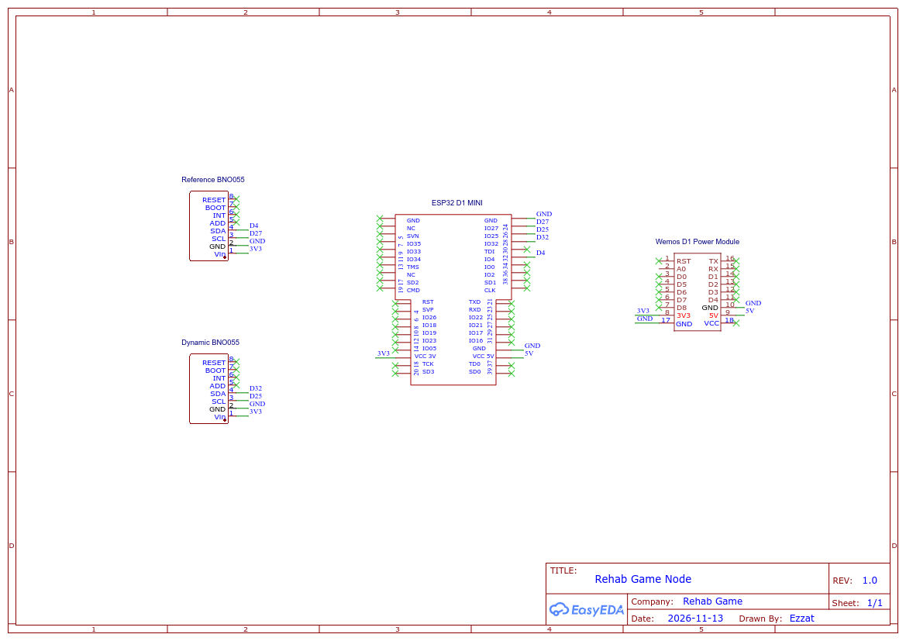

# 🔌 Penetapan Pin, Skematik Litar & Panduan Pendawaian (`esp32`)

Dokumen ini memperincikan sambungan fizikal, penetapan pin, laluan bus I2C berganda, dan skematik litar bagi **Nod Boleh Pakai Pemulihan Lutut ESP32 Dwi-BNO055**.

---

## 📑 Pilihan Bahasa / Language Options
* 🇲🇾 **[Dokumentasi Bahasa Melayu (Semasa)](PINOUT_AND_WIRING_MY.md)**
* 🇬🇧 **[English Documentation](PINOUT_AND_WIRING.md)**

---

## 🖼️ Skematik Litar & Pendawaian Perkakasan

  

* 📄 **Muat Turun Skematik Format PDF (Boleh Dicetak):** [`Schematic_rehabgame_2026-11-13.pdf`](Schematic_rehabgame_2026-11-13.pdf)
* 📄 **Muat Turun Vektor Skematik SVG:** [`schematic.svg`](schematic.svg)

---

## 📌 Jadual Penetapan Pin Mikropengawal

| Pin ESP32 | Komponen Disambung | Pin Modul | Isyarat / Bus | Voltan Operasi | Fungsi & Keterangan Teknikal |
| :--- | :--- | :--- | :--- | :--- | :--- |
| **GPIO 4** | Penderia Peha (#1) | `SDA` | I2C Bus 0 (`Wire`) | Logik 3.3V | Talian Data Bersiri untuk segmen Peha (*Thigh/Proximal*) |
| **GPIO 27** | Penderia Peha (#1) | `SCL` | I2C Bus 0 (`Wire`) | Logik 3.3V | Talian Jam Bersiri untuk segmen Peha (*Thigh/Proximal*) |
| **GPIO 32** | Penderia Betis (#2) | `SDA` | I2C Bus 1 (`TwoWire(1)`) | Logik 3.3V | Talian Data Bersiri untuk segmen Betis (*Calf/Distal*) |
| **GPIO 25** | Penderia Betis (#2) | `SCL` | I2C Bus 1 (`TwoWire(1)`) | Logik 3.3V | Talian Jam Bersiri untuk segmen Betis (*Calf/Distal*) |
| **3V3** | BNO055 #1 &amp; #2 | `VIN` / `VCC` | Rel Kuasa | 3.3V DC | Bekalan kuasa terkawal 3.3V dari pengatur voltan ESP32 |
| **GND** | BNO055 #1 &amp; #2 | `GND` | Rel Bumi | 0V | Satah rujukan bumi sepunya (*Common System Ground*) |

### Konfigurasi Pin Protokol & Pengalamatan (Modul BNO055)

| Pin Penderia | Sambungan Fizikal | Keadaan Logik | Tujuan Operasi |
| :--- | :--- | :--- | :--- |
| **PS0** | Sambung ke **GND** | Logik RENDAH (LOW) | Menetapkan mod komunikasi protokol piawai I2C |
| **PS1** | Sambung ke **GND** | Logik RENDAH (LOW) | Menetapkan mod komunikasi protokol piawai I2C |
| **ADR / COM** | Sambung ke **GND** | Logik RENDAH (LOW) | Menetapkan alamat lalai I2C **`0x29`** pada setiap bus fizikal berasingan |
| **RST** | Sambung ke **3.3V** / Biar Terbuka | Logik TINGGI (HIGH) | Memastikan BNO055 tidak masuk mod set semula (*Pull-up aktif*) |

---

## 🧰 Senarai Bahan & Komponen (BOM)

| Bil | Komponen | Spesifikasi Teknikal | Kuantiti | Fungsi Utama |
| :--- | :--- | :--- | :---: | :--- |
| 1 | **ESP32 DevKit** | 240 MHz Dwi-Teras Tensilica LX6, Bluetooth Klasik 4.2 BR/EDR | 1 | Unit pemprosesan kinematik utama & penghantaran telemetri |
| 2 | **Bosch BNO055** | Penderia Orientasi Mutlak Pintar 9-Paksi | 2 | Pengekstrakan vektor graviti bagi segmen Peha dan Betis |
| 3 | **Tali Velkro Elastik** | Fabrik elastik gred perubatan mudah laras | 2 | Pemasangan kemas dan kukuh pada bahagian peha dan betis pesakit |
| 4 | **Wayar Silikon Fleksibel** | 28 AWG multi-lembar, rintangan lentur tinggi | 1 set | Sambungan tahan lasak merentasi sendi lutut pesakit |
| 5 | **Sumber Kuasa** | Bateri Li-ion 3.7V (bersama modul 5V) / Power Bank 5V | 1 | Operasi klinikal mudah alih dan selamat tanpa wayar ke dinding |
| 6 | **Bekas Pelindung (Casing)**| Cetakan 3D bahan PETG / PLA ringan | 2 | Perlindungan mekanikal daripada impak dan gegaran |

---

## ⚡ Langkah Keselamatan Elektrikal & Mekanikal

1. **Dua Bus I2C Fizikal Bebas:**
   - Daripada berkongsi satu bus I2C yang memerlukan pertukaran pin alamat secara perisian, sistem menggunakan perkakasan dwi-pengawal I2C ESP32 (`Wire` dan `TwoWire(1)`).
   - Ini mengelakkan sebarang risiko pertembungan alamat I2C, mengurangkan beban kapasitans talian, dan mengelakkan *crosstalk* semasa pesakit membengkokkan kaki dengan laju.
2. **Perlindungan Tergantung Bus I2C (`Wire.setTimeOut(30)`):**
   - Kod pelaksanaan I2C biasa boleh membekukan CPU mikropengawal jika talian jam (SCL) terganggu akibat wayar longgar.
   - Had masa tindak balas perkakasan (*timeout*) dikunci pada `30 ms` untuk kedua-dua bus, membolehkan pemulihan automatik tanpa sistem tergantung.
3. **Kapasitor Nyahganding & Penapis Hingar:**
   - Papan modul BNO055 dilengkapi kapasitor seramik 100 nF merentasi talian `VIN` dan `GND`.
   - Perintang *pull-up* terbina (4.7 kΩ / 10 kΩ) pada pin SDA/SCL memastikan bentuk gelombang isyarat kekal bersih sepanjang wayar sambungan sehingga 60 cm.
4. **Pelepasan Ketegangan Wayar (*Strain Relief*):**
   - Wayar yang merentasi sendi lutut dilengkapi lilitan pelindung lingkaran dan gelung lebihan (*service loop*) bagi mengelakkan wayar ditarik tegang semasa fleksi penuh 90°.
